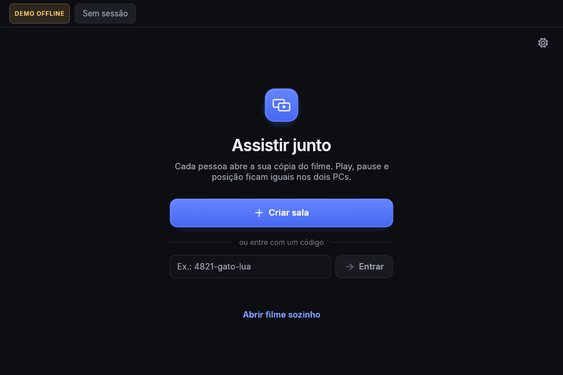
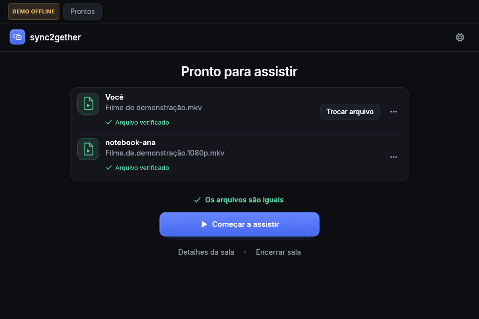
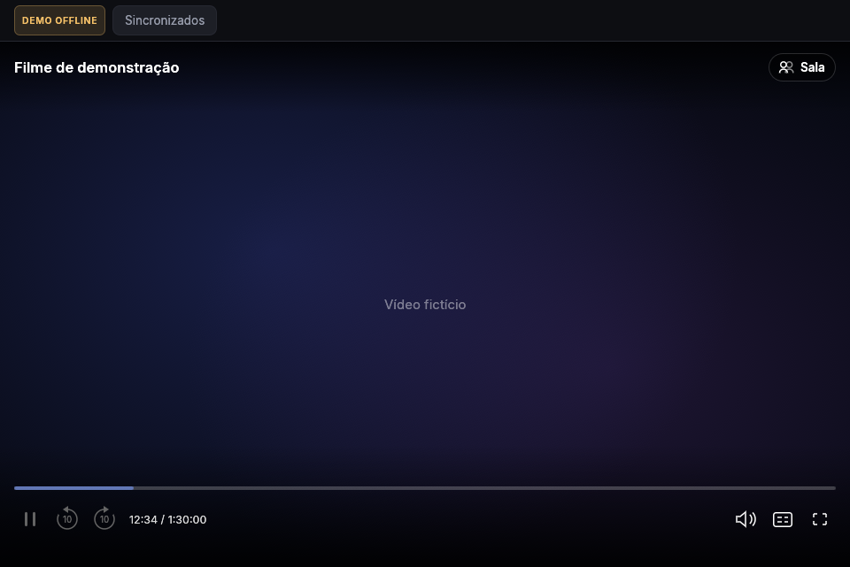
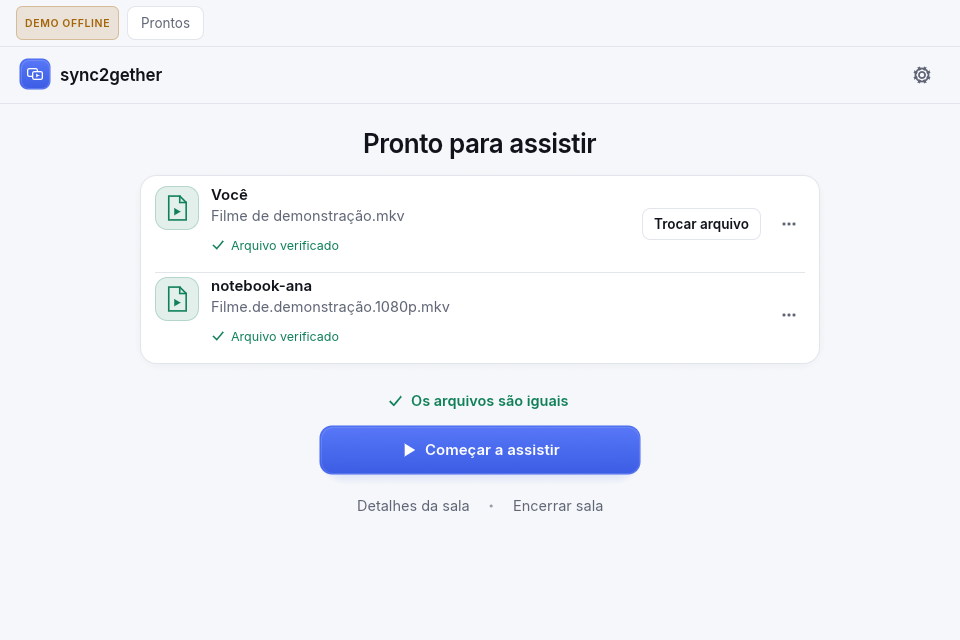

# sync2gether

Assista ao mesmo filme com outra pessoa, à distância. Uma cópia local em cada
PC, com play, pause e posição de reprodução sincronizados pela internet, sem
VPN, ou pela rede local.

[Baixar](https://github.com/8bury/sync2gether/releases) ·
[Instalar](#instalação) · [Como funciona](#como-funciona) ·
[Screenshots](#screenshots) · [Desenvolver](#desenvolvimento)



*Captura do modo demo offline, com dados fictícios. As imagens desta página
mostram a interface; não demonstram reprodução ou sincronização real.*

## Como funciona

O sync2gether é um aplicativo de desktop para duas pessoas. Cada PC reproduz o
filme com libmpv. Quando ambos têm a cópia local, a conexão envia apenas
comandos e informações de sincronização; quando apenas o anfitrião tem o
arquivo, o convidado pode assistir por **streaming P2P direto (QUIC cifrado)**
sem passar vídeo pelo servidor relay.

1. Uma pessoa clica em **Criar sala** e recebe um código como `4821-gato-lua`.
2. Ela envia o código para a outra pessoa, que abre **Entrar com código**, digita e clica em **Entrar**.
3. Cada pessoa escolhe sua cópia do filme — ou o convidado clica em **Assistir por streaming P2P**
   para receber o arquivo direto do anfitrião com cache progressivo em disco. Quando ambos estão prontos, qualquer participante pode clicar em
   **Começar a assistir**.
4. Play, pause e mudanças de posição acompanham os dois players. Volume,
   áudio e legendas são ajustados separadamente em cada PC.

Pela internet, os dois apps se conectam com TLS a um [relay](docs/relay.md) que
só repassa mensagens cifradas de ponta a ponta com uma chave derivada do código.
Salas na rede local ou VPN, com descoberta e aprovação de entrada, continuam
disponíveis em **Configurações → Opções avançadas de rede**.

O app também verifica os arquivos, agenda o início, corrige desvios e reconecta
o convidado sozinho. É possível abrir um filme sozinho.

Quem não tem o app pode entrar como convidado **pelo navegador**, com um link
que o anfitrião copia na sala: com a própria cópia do filme ou por streaming
P2P direto (WebRTC). No streaming, o anfitrião também adapta MKV e áudio
AC-3/E-AC-3/DTS sob demanda para MSE (sem recodificar vídeo) com escolha de
faixa de áudio; veja [Convidado no navegador](docs/navegador.md).

A interface está disponível em português (Brasil) e inglês. Na primeira
abertura, o app segue o idioma do sistema (inglês quando ele não é português);
a escolha em **Configurações → Idioma** fica salva. O código da sala é o mesmo
nos dois idiomas, então pessoas com idiomas diferentes entram na mesma sala.

## Instalação

Baixe o pacote para seu sistema operacional e o arquivo `SHA256SUMS` em
[Releases](https://github.com/8bury/sync2gether/releases). Há pacotes para
**Windows (x86_64)**, **macOS (Apple Silicon e Intel)**, **Arch Linux atualizado**
e **Ubuntu 24.04** (Linux em x86_64).
As salas pela internet no relay padrão (TLS) exigem a 0.4.0 ou mais nova nos
dois PCs; o streaming P2P direto exige a 0.5.0 nos dois PCs.

### Windows (x86_64)

- **Instalador:** baixe e execute `sync2gether-0.7.1-windows-x86_64-setup.exe`.
  Instala na pasta do usuário sem exigir privilégios de administrador e já inclui
  `libmpv-2.dll`.
- **Portátil:** extraia `sync2gether-0.7.1-windows-x86_64.zip` e execute
  `sync2gether.exe`, mantendo `libmpv-2.dll` na mesma pasta.

O executável ainda não possui assinatura digital da Microsoft. Se o **Windows
SmartScreen** bloquear a execução, clique em **Mais informações → Executar
assim mesmo**. Para salas na rede local ou streaming P2P direto, permita o
acesso na rede privada quando o Firewall do Windows solicitar.

### macOS (Apple Silicon e Intel)

- **Apple Silicon (M1 ou mais novo):** baixe `sync2gether-0.7.1-macos-arm64.dmg`.
- **Intel (x86_64):** baixe `sync2gether-0.7.1-macos-x86_64.dmg`.

Abra o `.dmg` e arraste **sync2gether.app** para a pasta **Applications**. A
biblioteca `libmpv` e suas dependências já estão embutidas no `.app`.

O aplicativo ainda não é assinado/notarizado pela Apple. Se o **Gatekeeper**
impedir a primeira abertura, remova o atributo de quarentena no Terminal e abra
novamente:

```sh
xattr -cr /Applications/sync2gether.app
```

Para salas na rede local ou streaming P2P direto, permita o acesso à **Rede
Local** quando o macOS solicitar.

### Arch Linux

```sh
sudo pacman -U ./sync2gether-0.7.1-1-x86_64.pkg.tar.zst
```

### Ubuntu 24.04

```sh
sudo apt install ./sync2gether_0.7.1_amd64.deb
```

No Linux, os gerenciadores instalam as dependências, incluindo libmpv. Abra
**sync2gether** pelo menu de aplicativos ou execute `sync2gether` no terminal.
O seletor de arquivos usa o portal do desktop; em ambientes mínimos, configure
um backend como `xdg-desktop-portal-gtk` ou `xdg-desktop-portal-kde`.

Para conferir os arquivos baixados, execute na pasta dos pacotes:

```sh
sha256sum --ignore-missing -c SHA256SUMS
```

No PowerShell (Windows), use `Get-FileHash <arquivo> -Algorithm SHA256`; no
macOS, `shasum -a 256 --ignore-missing -c SHA256SUMS`.

O pacote Ubuntu não é compatível com 22.04. O pacote Arch requer as bibliotecas
de um sistema atualizado. Os binários de release não incluem o modo demo.

## Screenshots

Todas as capturas abaixo usam os cenários fictícios do modo demo offline.

### Escolham o filme

Os dois arquivos aparecem lado a lado, com o resultado da comparação de
conteúdo entre eles, antes de começar.



### Assistam juntos

O player reúne a linha do tempo, play/pause, saltos de 10 segundos, volume,
faixas de áudio, legendas e tela cheia. A presença, no canto, mostra se a
outra pessoa está em sincronia e abre os detalhes da sessão.



<details>
<summary>Ver a preparação no tema claro</summary>

O tema claro fica disponível em **Configurações**, no ícone de engrenagem do cabeçalho.



</details>

## Antes da sessão

- Os arquivos precisam ter o mesmo conteúdo completo. O app compara tamanho e
  hash BLAKE3; nomes diferentes são aceitos, mas remuxes e alterações de
  metadados podem tornar os arquivos incompatíveis. A verificação ocorre em
  segundo plano e pode levar algum tempo em arquivos grandes.
- Pela internet, os dois PCs precisam de conexão TLS/TCP de saída para
  `relay.pedrosales.dev:7843`. Não é preciso abrir portas no roteador.
- Na rede local, a porta padrão da sala é TCP `7842` e a descoberta usa UDP
  `7841`, com multicast e broadcast IPv4. Se a sala não aparecer, use
  **Conectar por endereço**. O app não instala nem configura uma VPN.
- Uma desconexão, falha do player ou fim do filme pausa a sessão. Se um player
  precisar carregar cache durante o streaming P2P, a reprodução exibe o status
  de carregamento, a velocidade e a barra de cache nos dois PCs e retoma
  sozinha assim que o buffer estabiliza; quedas rápidas do túnel P2P reconectam
  em segundo plano preservando o que já está em cache. Após reconexão de rede,
  os players recuperam a posição do anfitrião e aguardam um novo play. Fechar o
  anfitrião encerra a sala e avisa o convidado; quando o convidado sai, o
  anfitrião vê que a outra pessoa saiu, não uma queda de conexão.

Veja o [guia de uso](docs/uso.md) para conexão manual, troca de arquivos,
controles e atalhos. Chamadas de voz podem acontecer em um aplicativo separado.

## Desenvolvimento

A stack usa Rust, egui/eframe com OpenGL, Tokio, Serde e libmpv.
O arquivo `rust-toolchain.toml` fixa a versão do Rust.

Depois de instalar as [dependências de desenvolvimento](docs/desenvolvimento.md#ambiente-de-desenvolvimento):

```sh
cargo run --locked
```

Para explorar a interface com dados fictícios, sem carregar filmes ou abrir sockets:

```sh
cargo run --locked --features demo -- --demo --demo-state ready
```

As verificações do projeto rodam com:

```sh
bash scripts/check.sh
```

| Guia | Conteúdo |
| --- | --- |
| [Uso](docs/uso.md) | Salas, rede, arquivos, controles e atalhos |
| [Desenvolvimento e testes](docs/desenvolvimento.md) | Dependências, demo, capturas e testes com vídeo sintético |
| [Arquitetura e sincronização](docs/arquitetura.md) | Módulos, libmpv, protocolo e correção de desvio |
| [Salas pela internet e relay](docs/relay.md) | Código da sala, criptografia, reconexão e publicação do servidor |
| [Convidado no navegador](docs/navegador.md) | Link para navegador, cópia própria, streaming WebRTC, limites e publicação da página |
| [Diagnóstico](docs/diagnostico.md) | Logs, GDB e travamentos em Wayland |
| [Empacotamento e Release](docs/empacotamento.md) | Builds para Linux, Windows e macOS |
| [Histórico de validação](docs/validacao.md) | Ambientes e cenários testados nas revisões anteriores |
| [Notas da versão 0.7.1](docs/releases/v0.7.1.md) | Aviso quando a outra pessoa sai ou o anfitrião encerra a sala |
| [Notas da versão 0.7.0](docs/releases/v0.7.0.md) | Nova interface minimalista, temas claro e escuro e fluxo de entrada por código |
| [Notas da versão 0.6.0](docs/releases/v0.6.0.md) | Builds oficiais para Windows e macOS, reconexão P2P e barra de cache |
| [Notas da versão 0.5.0](docs/releases/v0.5.0.md) | Streaming P2P direto (QUIC E2EE), cache progressivo e validação |
| [Notas da versão 0.4.0](docs/releases/v0.4.0.md) | TLS no transporte do relay, modularização e validação |
| [Notas da versão 0.3.0](docs/releases/v0.3.0.md) | Novo fluxo das telas, validação e limites |
| [Notas da versão 0.2.0](docs/releases/v0.2.0.md) | Salas pela internet, validação e limites |
| [Notas da versão 0.1.0](docs/releases/v0.1.0.md) | Pacotes, validação e limites da release |

As instruções para agentes estão em [AGENTS.md](AGENTS.md).

## Validação e limites

As salas pela internet foram testadas com o relay em localhost, incluindo
código errado, queda do enlace, reinício do relay e dois players libmpv reais
com ~250 ms de ida e volta simulados, e com o relay publicado; veja as
[notas da 0.2.0](docs/releases/v0.2.0.md). Os pacotes 0.1.0 foram compilados,
instalados e exercitados em containers Arch e Ubuntu 24.04. Os testes usaram TCP em localhost, dois players libmpv com vídeo
sintético, atraso e jitter de rede, áudio virtual e OpenGL com Xvfb/Mesa por
software. A interface também foi revisada em CachyOS com Wayland/Hyprland.

Esses cenários não comprovam saída física de áudio, descoberta por uma VPN real
ou desempenho em GPUs diferentes.
Filmes longos, HDR e fidelidade de cores precisam de validação adicional.
Consulte os [detalhes da validação da release](docs/releases/v0.1.0.md#validação-e-limites).
